# Stage 2 — Active Directory Implementation

## 1. Project Overview

The second stage of the A&J Market IT Infrastructure Lab focused on implementing Active Directory Domain Services (AD DS) to establish centralized user and computer management.

A Windows Server 2025 virtual machine was configured as the domain controller. A new Active Directory domain was created, organizational units were established to organize company accounts and computers, and employee accounts were created using PowerShell.

The Windows 11 client computer was then joined to the domain to test centralized authentication.

## 2. Environment Configuration

| Component | Configuration |
|---|---|
| Cloud Platform | Microsoft Azure |
| Domain Controller | `AZ-DC01` |
| Client Computer | `AZ-CLIENT01` |
| Server Operating System | Windows Server 2025 Datacenter |
| Client Operating System | Windows 11 Pro |
| Active Directory Domain | `corp.ajmarket.test` |
| NetBIOS Name | `CORP` |
| Domain Controller IP | `10.0.0.4` |
| Administrator Account | `CORP\john_admin` |
| PowerShell Script | `AJMarket_CreateEmployees.ps1` |

## 3. Technologies & Skills Demonstrated

- Active Directory Domain Services (AD DS)
- Windows Server 2025 administration
- Domain controller configuration
- Active Directory domain creation
- Organizational Unit (OU) management
- User and administrator account management
- Active Directory security groups
- PowerShell scripting
- Bulk employee account creation
- Windows domain joining
- Domain authentication and login testing

## 4. Implementation Stages

1. **Install Active Directory Domain Services:** Added the AD DS server role to Windows Server 2025.
2. **Promote the Server to Domain Controller:** Created the new forest and domain `corp.ajmarket.test`.
3. **Create Organizational Units:** Established `_EMPLOYEES`, `_ADMINS`, and `_CLIENTS` to organize directory objects.
4. **Create an Administrator Account:** Created `john_admin` and assigned the appropriate domain administrator membership.
5. **Create Employee Accounts:** Used a PowerShell script to generate 20 employee accounts within the `_EMPLOYEES` OU.
6. **Join the Client to the Domain:** Joined `AZ-CLIENT01` to `corp.ajmarket.test` and organized its computer object within `_CLIENTS`.
7. **Test Domain Authentication:** Signed in to the Windows 11 client using a domain employee account to verify authentication.

## 5. Project Outcome

Successfully established a centralized Active Directory environment for the simulated A&J Market business.

The completed configuration allows administrators to manage employee accounts and computers from a centralized directory rather than managing each computer independently.

This environment provides the foundation for the next stage, which focuses on account security and Group Policy.

---

## 6. Detailed Implementation Walkthrough

### Step 1: Install Active Directory Domain Services (AD DS)

Active Directory Domain Services was installed on `AZ-DC01` to provide centralized management of user accounts, computers, and authentication for A&J Market.

**Implementation:**

1. Connected to the Windows Server 2025 virtual machine `AZ-DC01` using Remote Desktop.
2. Opened **Server Manager**.
3. Selected **Manage > Add Roles and Features**.
4. Chose **Role-based or feature-based installation**.
5. Selected `AZ-DC01` as the destination server.
6. Under **Server Roles**, selected **Active Directory Domain Services**.
7. Accepted the additional required features.
8. Continued through the installation wizard and selected **Install**.
9. Waited for the installation to complete.

**Expected Result:** Server Manager displayed a successful AD DS role installation notification and provided the option to promote `AZ-DC01` to a domain controller.

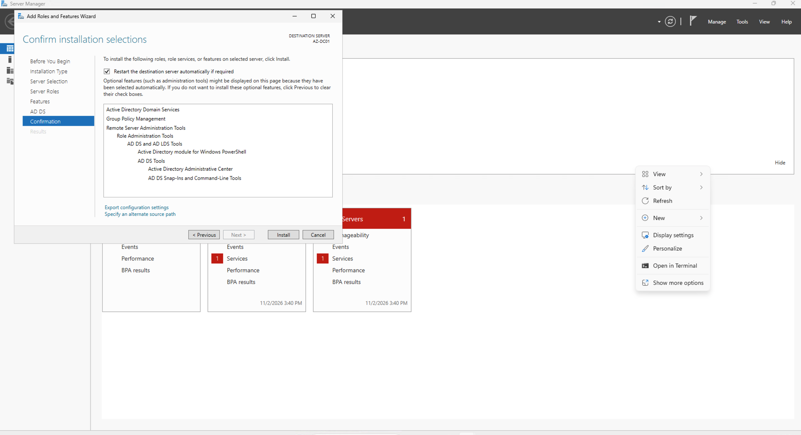

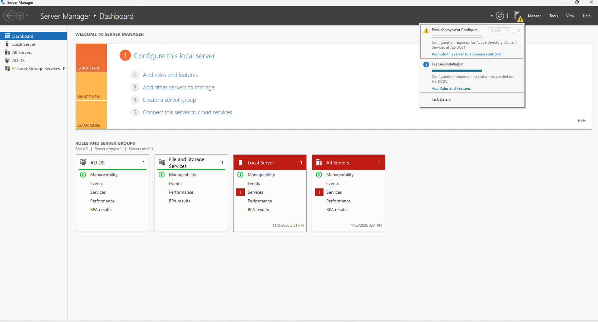

### Step 2: Promote AZ-DC01 to a Domain Controller

After installing AD DS, the server was promoted to a domain controller to establish the A&J Market Active Directory domain.

**Implementation:**

1. Opened **Server Manager** on `AZ-DC01`.
2. Clicked the notification flag in the upper-right corner.
3. Selected **Promote this server to a domain controller**.
4. Under **Deployment Configuration**, selected **Add a new forest**.
5. Entered `corp.ajmarket.test` as the root domain name.
6. Under **Domain Controller Options**, kept DNS Server and Global Catalog selected and configured a Directory Services Restore Mode (DSRM) password.
7. Continued through DNS Options without creating a DNS delegation.
8. Confirmed the NetBIOS domain name as `CORP`.
9. Accepted the default Active Directory database, log, and SYSVOL paths.
10. Reviewed the configuration and ran the prerequisite checks.
11. Confirmed that all prerequisite checks passed.
12. Selected **Install** to begin domain controller promotion.
13. Allowed the server to restart after the promotion completed.
14. Opened **Active Directory Users and Computers** and verified that `corp.ajmarket.test` appeared.

**Expected Result:** `AZ-DC01` became the domain controller for the new `corp.ajmarket.test` Active Directory forest.

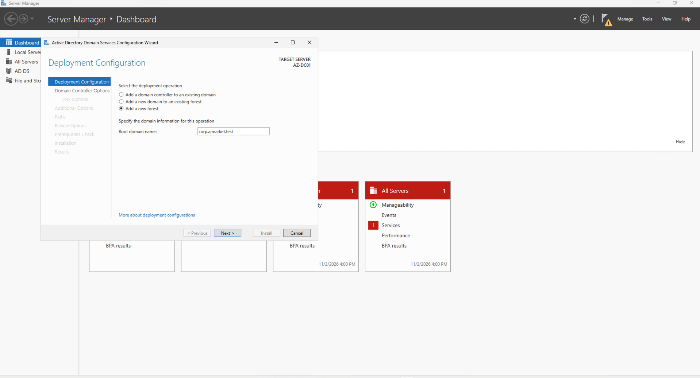

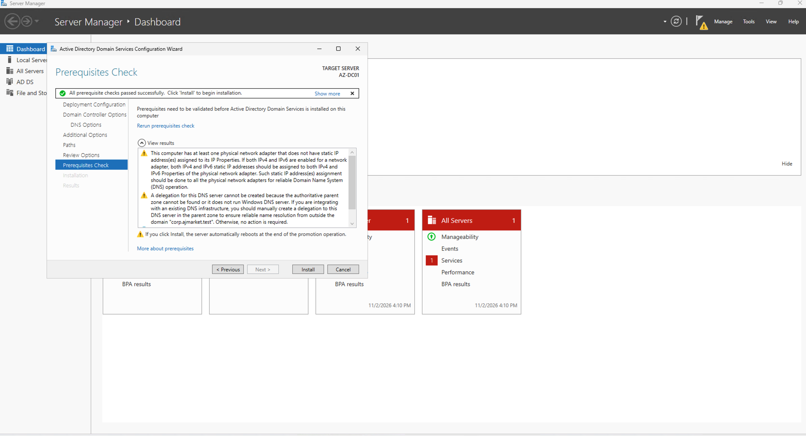

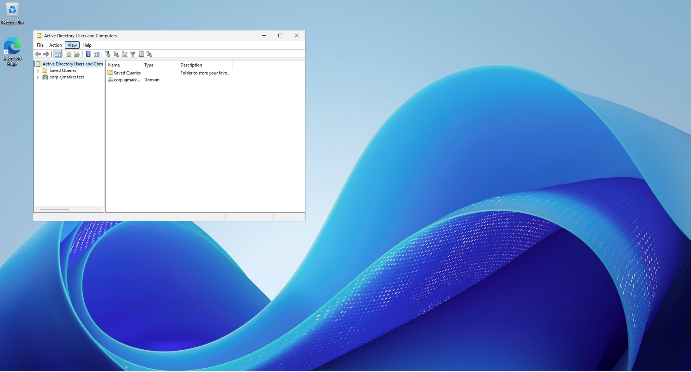

### Step 3: Create Organizational Units (OUs)

Organizational Units were created to separate employees, administrators, and client computers within Active Directory.

**Implementation:**

1. Opened **Server Manager > Tools > Active Directory Users and Computers**.
2. Expanded the `corp.ajmarket.test` domain.
3. Right-clicked the domain and selected **New > Organizational Unit**.
4. Created an OU named `_EMPLOYEES`.
5. Repeated the process to create `_ADMINS`.
6. Created a third OU named `_CLIENTS`.
7. Verified that all three OUs appeared under the domain.

**Expected Result:** Active Directory displayed `_EMPLOYEES`, `_ADMINS`, and `_CLIENTS` under `corp.ajmarket.test`.

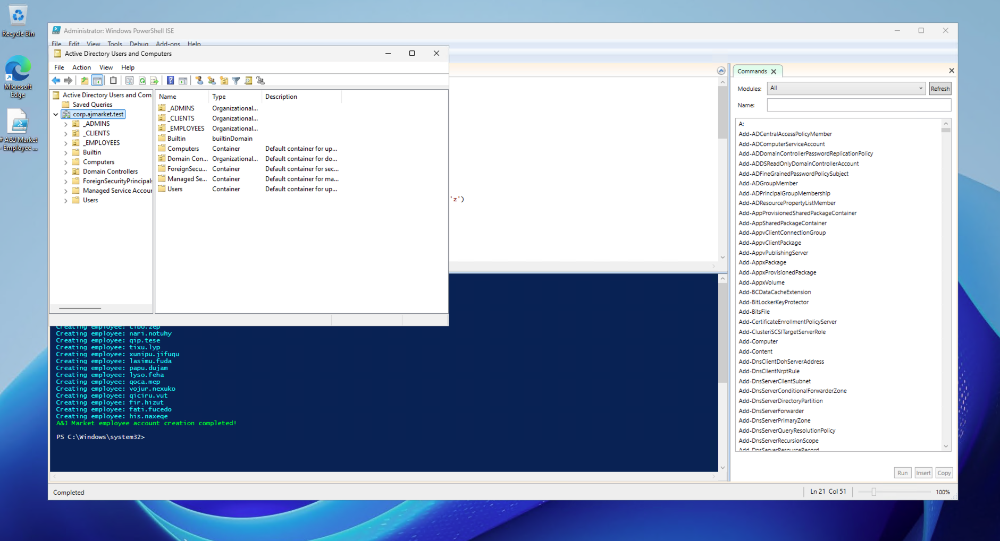

### Step 4: Create a Domain Administrator Account

A dedicated administrator account was created to perform domain administration tasks.

**Implementation:**

1. Opened **Active Directory Users and Computers**.
2. Right-clicked the `_ADMINS` OU.
3. Selected **New > User**.
4. Entered the user information for John Fitz.
5. Assigned the username `john_admin`.
6. Configured the account password and completed the user creation wizard.
7. Opened the new account's **Properties**.
8. Selected the **Member Of** tab.
9. Added the account to the **Domain Admins** security group.
10. Verified that John Fitz appeared inside the `_ADMINS` OU.

**Expected Result:** The `CORP\john_admin` account was created and assigned domain administrator privileges.

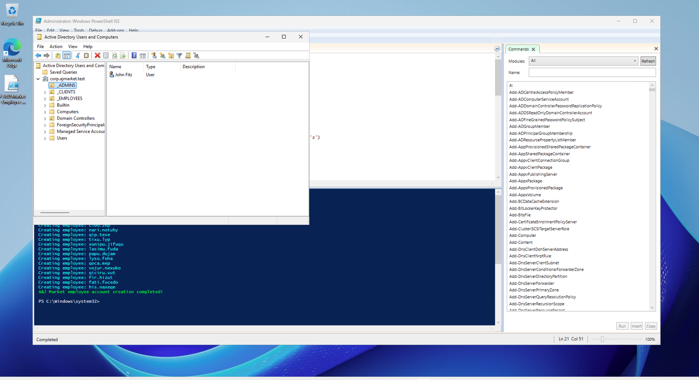

### Step 5: Create 20 Employee Accounts Using PowerShell

PowerShell automation was used to create multiple employee accounts efficiently instead of manually creating each account.

**Implementation:**

1. Connected to `AZ-DC01`.
2. Opened **Windows PowerShell ISE** with administrator privileges.
3. Prepared the employee creation script named `AJMarket_CreateEmployees.ps1`.
4. Configured the script to create 20 employee accounts.
5. Set the destination Organizational Unit to `_EMPLOYEES` within `corp.ajmarket.test`.
6. Used Active Directory PowerShell commands to create the user accounts.
7. Executed the script.
8. Reviewed the PowerShell output confirming that employee account creation completed.
9. Opened **Active Directory Users and Computers**.
10. Selected `_EMPLOYEES` and verified that all 20 accounts appeared.

**Expected Result:** Twenty employee accounts were created in the `_EMPLOYEES` OU.

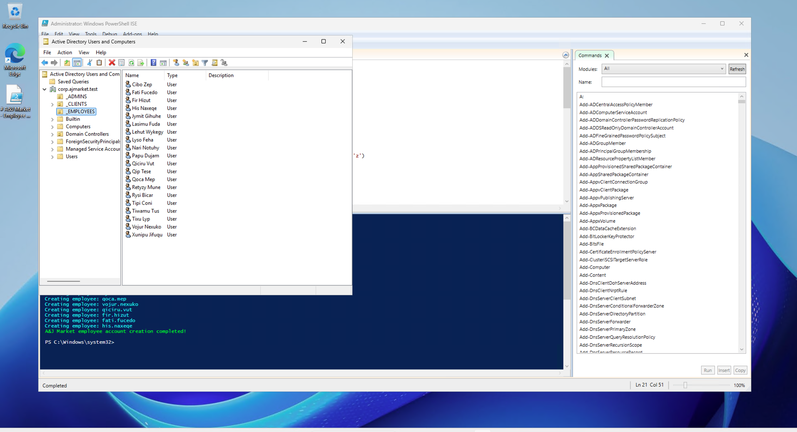

The account `qip.tese` was selected for later domain authentication and security testing.

### Step 6: Join AZ-CLIENT01 to the Domain

The Windows 11 client was joined to the Active Directory domain to allow employees to sign in using centralized domain credentials.

**Implementation:**

1. Verified that the client computer `AZ-CLIENT01` used `10.0.0.4` as its DNS server.
2. Connected to `AZ-CLIENT01` using Remote Desktop.
3. Opened the Windows system settings for changing computer domain membership.
4. Selected the option to join an Active Directory domain.
5. Entered `corp.ajmarket.test` as the domain name.
6. Provided domain administrator credentials using `CORP\john_admin`.
7. Confirmed the successful domain join.
8. Restarted the client computer.
9. On `AZ-DC01`, opened **Active Directory Users and Computers**.
10. Located the `AZ-CLIENT01` computer object.
11. Moved the computer object into the `_CLIENTS` OU.
12. Verified that `AZ-CLIENT01` appeared inside `_CLIENTS`.

**Expected Result:** The Windows 11 client successfully joined `corp.ajmarket.test` and appeared in the `_CLIENTS` Organizational Unit.

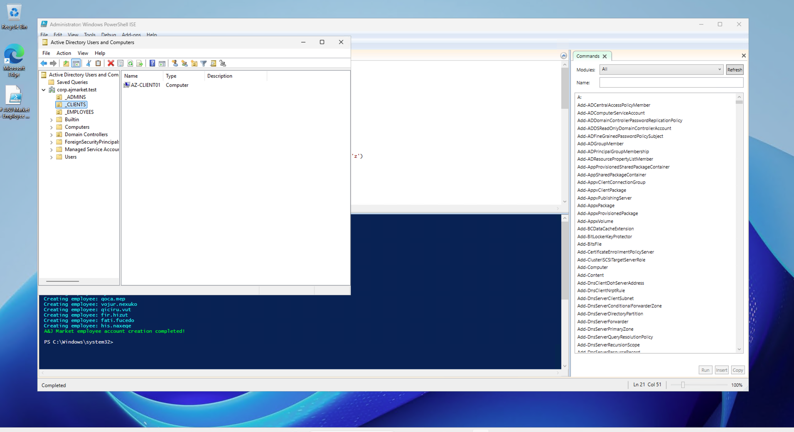

### Step 7: Test Employee Domain Authentication

An employee account was used to verify that the Windows 11 client could authenticate users through Active Directory.

**Implementation:**

1. Configured Remote Desktop access on `AZ-CLIENT01` for domain users.
2. Opened the Remote Desktop connection to `AZ-CLIENT01`.
3. Entered the domain employee username `CORP\qip.tese`.
4. Entered the employee account password.
5. Connected to the Windows 11 client.
6. Confirmed that the Windows desktop loaded successfully.
7. Opened the Start menu and verified that the signed-in account displayed **Qip Tese**.

**Expected Result:** The employee successfully signed in to the domain-joined Windows 11 client using Active Directory credentials.

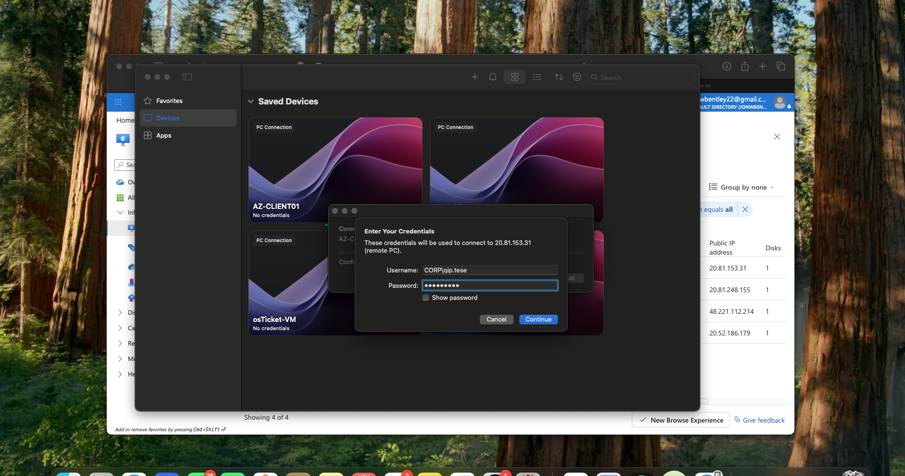

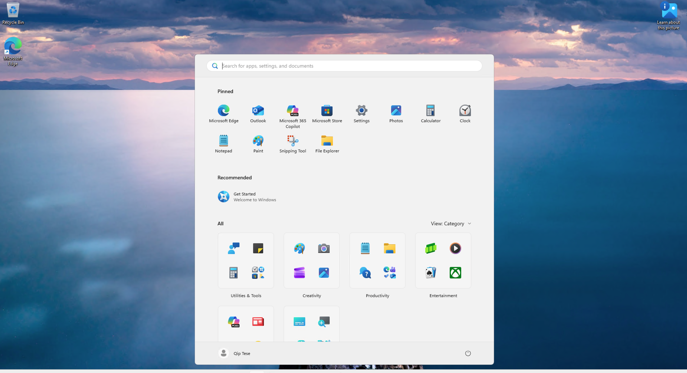

## 7. Implementation Results

The Active Directory implementation established centralized identity and computer management for the simulated A&J Market environment.

The lab demonstrated the ability to install and configure Active Directory Domain Services, deploy a domain controller, organize directory objects, automate user provisioning with PowerShell, join Windows computers to a domain, and verify employee authentication.

The environment was then used for additional labs involving account lockout policies, account administration, DNS, and network file permissions.
