# Stage 3 — Account Security and Group Policy

## 1. Project Overview

This stage focuses on implementing and testing account security controls in the A&J Market Active Directory environment.

Using Windows Server 2025 and Windows 11, I configured account lockout policies through Group Policy, performed user account administration, and examined Windows Security Event Logs to monitor authentication activity.

The objective was to demonstrate practical skills in securing domain user accounts, troubleshooting authentication issues, and monitoring security events.

## 2. Environment Configuration

- **Cloud Platform:** Microsoft Azure
- **Domain Controller:** AZ-DC01 (Windows Server 2025)
- **Client Computer:** AZ-CLIENT01 (Windows 11 Pro)
- **Active Directory Domain:** corp.ajmarket.test
- **Domain Administrator:** CORP\john_admin
- **Test Employee Account:** CORP\qip.tese

## 3. Technologies and Tools

- Active Directory Domain Services (AD DS)
- Group Policy Management Console (GPMC)
- Active Directory Users and Computers (ADUC)
- Windows Local Security Policy
- Windows Event Viewer
- Remote Desktop Protocol (RDP)
- Windows PowerShell

## 4. Implementation Stages

1. Configure an account lockout policy using Group Policy.
2. Apply and verify the updated Group Policy settings.
3. Test account lockout using unsuccessful login attempts.
4. Unlock a locked employee account and reset its password.
5. Disable and re-enable an employee account to test access restrictions.
6. Enable successful and failed logon auditing on the Windows 11 client.
7. Review Windows Security Event Logs for authentication activity.

## 5. Project Outcome

Successfully implemented and tested account security controls within the A&J Market domain.

Configured an account lockout threshold of five failed sign-in attempts, with a 10-minute lockout duration and a 10-minute reset interval.

Demonstrated account unlocking, password resets, account disabling and re-enabling, and security event monitoring using Windows Event Viewer.

Verified authentication activity using Windows Security Event IDs 4624 (successful logon) and 4625 (failed logon).

## 6. Detailed Implementation Walkthrough

### Step 1: Configure Account Lockout Policy Using Group Policy

The first objective was to configure a domain-wide account lockout policy to protect employee accounts against repeated unsuccessful sign-in attempts.

**Implementation:**

1. Connected to the domain controller `AZ-DC01` using Remote Desktop.
2. Signed in using the domain administrator account `CORP\john_admin`.
3. Opened **Server Manager**.
4. Selected **Tools > Group Policy Management**.
5. Expanded **Forest: corp.ajmarket.test > Domains > corp.ajmarket.test**.
6. Right-clicked **Default Domain Policy** and selected **Edit**.
7. In Group Policy Management Editor, navigated to:

   `Computer Configuration > Policies > Windows Settings > Security Settings > Account Policies > Account Lockout Policy`

8. Opened **Account lockout threshold**.
9. Selected **Define this policy setting** and entered `5` invalid logon attempts.
10. Applied the setting and reviewed the additional account lockout settings suggested by Windows.
11. Confirmed the account lockout policy configuration.

**Expected Result:** The domain account lockout threshold was configured to lock employee accounts after five unsuccessful sign-in attempts.

**Screenshot Evidence:**

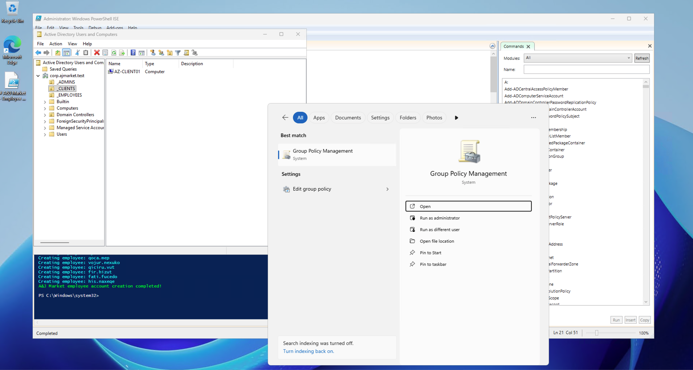

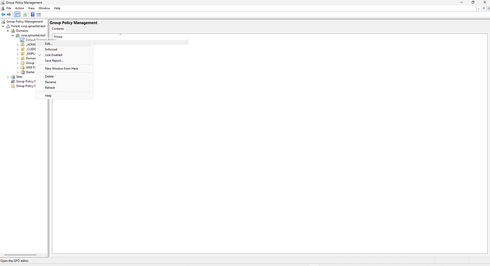

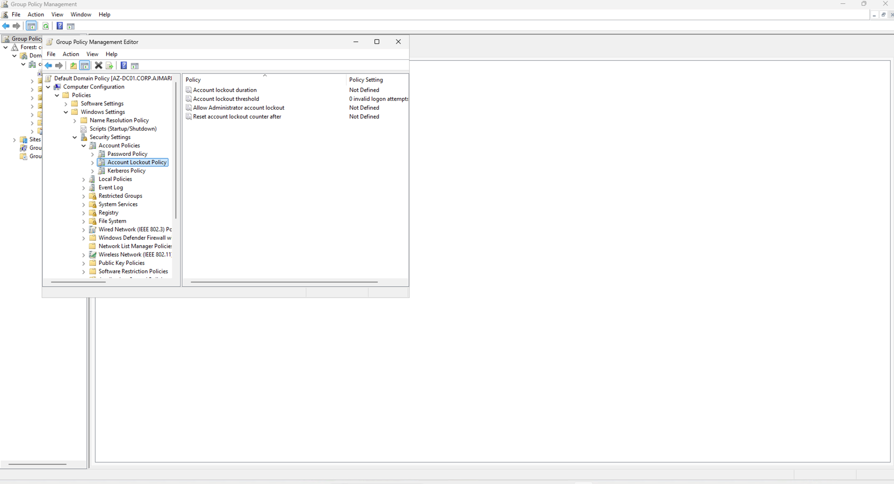

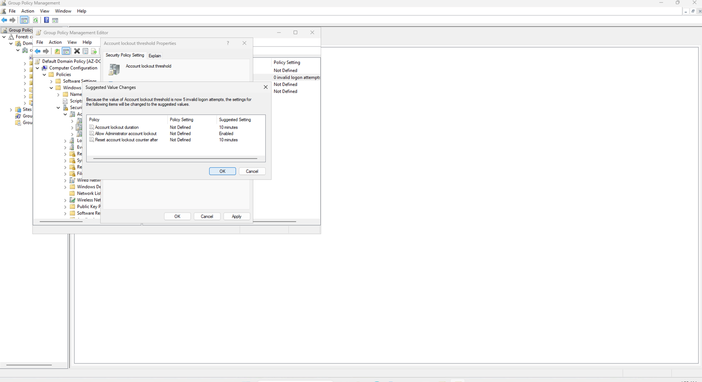

### Step 2: Test Account Lockout After Failed Login Attempts

After configuring the account lockout policy, I tested whether Active Directory would prevent an employee from signing in after repeated incorrect password attempts.

**Implementation:**

1. Connected to the Windows 11 client `AZ-CLIENT01` using Remote Desktop.
2. Selected the employee account `CORP\qip.tese`.
3. Attempted to sign in repeatedly using an incorrect password.
4. Continued testing until the account reached the configured threshold of five failed attempts.
5. Observed a Remote Desktop error indicating that the account had been locked.
6. Returned to the domain controller `AZ-DC01`.
7. Opened **Active Directory Users and Computers**.
8. Navigated to the `_EMPLOYEES` Organizational Unit.
9. Opened the properties of the Qip Tese employee account.
10. Selected the **Account** tab and verified that Active Directory identified the account as locked.

**Expected Result:** Active Directory locked the employee account after repeated failed authentication attempts, preventing further sign-ins until the account was unlocked or the lockout period expired.

**Screenshot Evidence:**

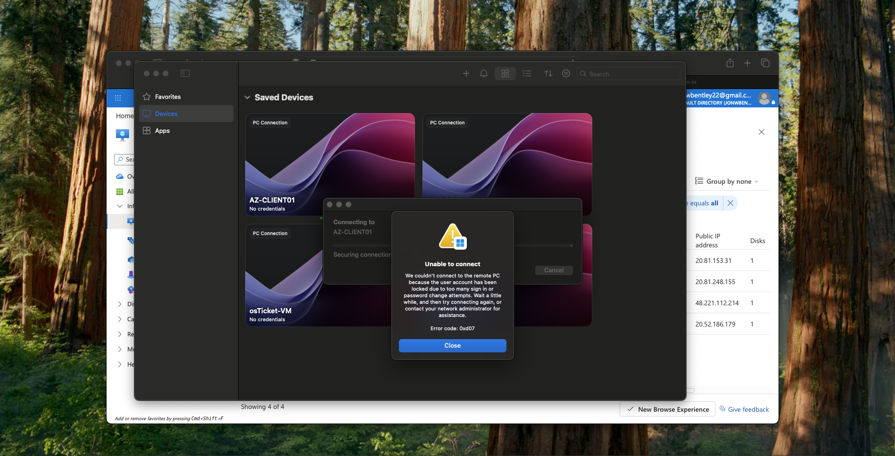

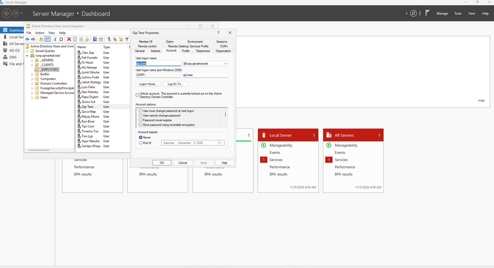

### Step 3: Unlock an Employee Account and Reset Its Password

After confirming that the account lockout policy worked, I used Active Directory Users and Computers to restore access to the employee account.

**Implementation:**

1. Connected to the domain controller `AZ-DC01`.
2. Opened **Server Manager > Tools > Active Directory Users and Computers**.
3. Expanded `corp.ajmarket.test` and selected the `_EMPLOYEES` Organizational Unit.
4. Located the employee account **Qip Tese** (`qip.tese`).
5. Right-clicked the account and selected **Properties**.
6. Opened the **Account** tab.
7. Selected the option to unlock the account and applied the change.
8. Right-clicked the employee account again and selected **Reset Password**.
9. Entered and confirmed a new password.
10. Completed the password reset.
11. Tested authentication using the updated employee credentials.

**Expected Result:** The employee account was unlocked, its password was reset, and the account could authenticate using the updated credentials.

**Screenshot Evidence:**

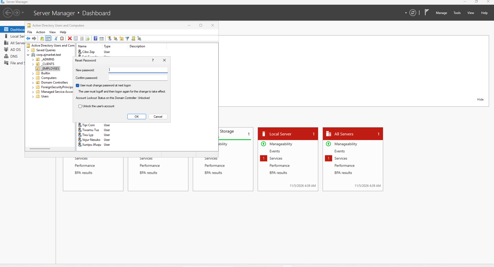

### Step 4: Disable and Re-Enable an Employee Account

The next objective was to demonstrate how an administrator can temporarily revoke and restore an employee's access to the domain.

**Implementation:**

1. Connected to the domain controller `AZ-DC01`.
2. Opened **Active Directory Users and Computers**.
3. Navigated to the `_EMPLOYEES` Organizational Unit.
4. Located the employee account **Qip Tese** (`qip.tese`).
5. Right-clicked the account and selected **Disable Account**.
6. Confirmed that Active Directory displayed a message indicating the account was disabled.
7. Attempted to connect to `AZ-CLIENT01` using the disabled employee account.
8. Observed a Remote Desktop error indicating that the account was disabled.
9. Returned to Active Directory Users and Computers.
10. Right-clicked the employee account and selected **Enable Account**.
11. Confirmed that Active Directory displayed a message indicating the account was enabled again.
12. Verified that the employee could sign in after the account was restored.

**Expected Result:** Disabling the employee account prevented domain authentication. Re-enabling the account restored the employee's ability to sign in.

**Screenshot Evidence:**

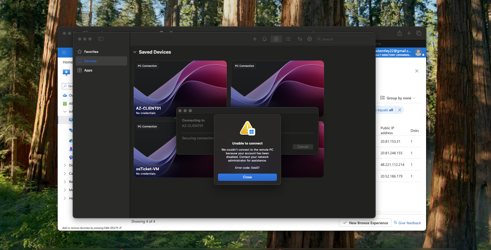

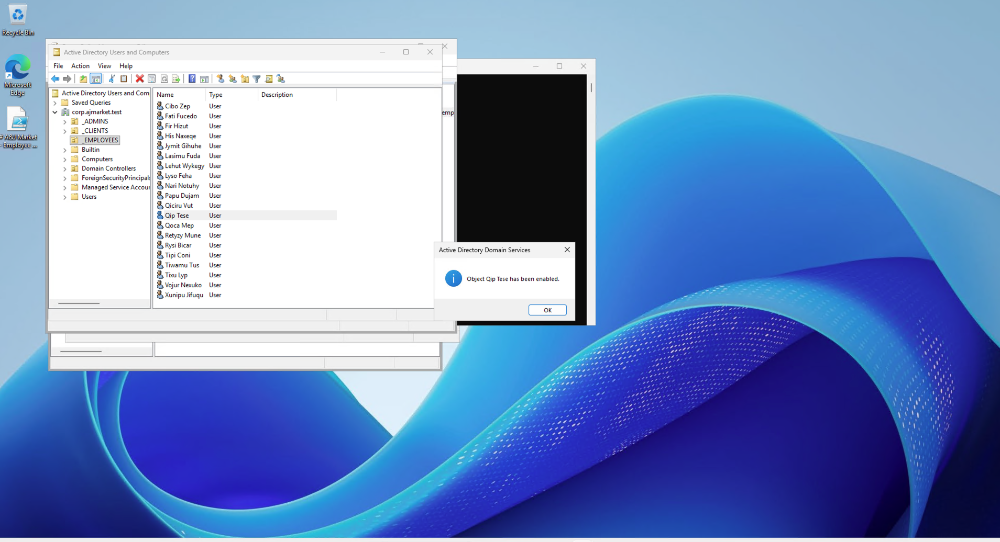

### Step 5: Monitor Authentication Events Using Windows Event Viewer

The final objective was to examine Windows Security Event Logs to identify successful and failed authentication attempts within the A&J Market environment.

**Implementation:**

1. Connected to the Windows 11 client `AZ-CLIENT01`.
2. Opened **Local Security Policy** (`secpol.msc`) using domain administrator credentials.
3. Navigated to **Local Policies > Audit Policy**.
4. Opened **Audit logon events** and enabled auditing for both **Success** and **Failure**.
5. Opened **Event Viewer**.
6. Navigated to **Windows Logs > Security**.
7. Examined the security logs for authentication activity.
8. Identified **Event ID 4625**, which represents a failed logon attempt.
9. Identified **Event ID 4624**, which represents a successful logon.
10. Connected to the domain controller `AZ-DC01` and opened Event Viewer.
11. Reviewed the domain controller's Security logs, including **Event ID 4776**, associated with credential validation.

**Expected Result:** Windows recorded authentication events that could be reviewed to investigate failed sign-in attempts and verify successful authentication.

**Screenshot Evidence:**

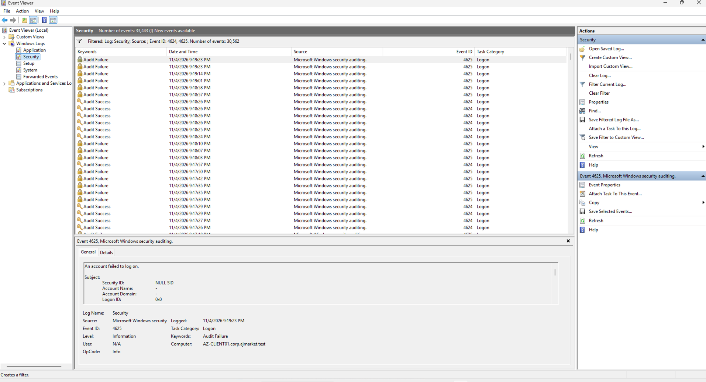

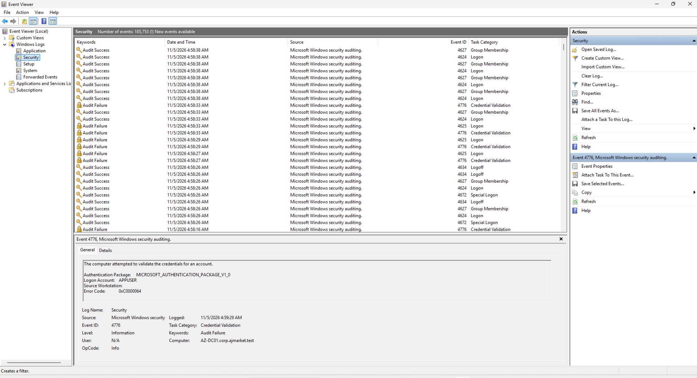

## 7. Implementation Results

This lab demonstrated how Active Directory and Windows security tools can be used to protect and manage employee accounts.

The completed exercises included configuring an account lockout policy, testing failed sign-in attempts, unlocking accounts, resetting passwords, disabling and re-enabling accounts, and reviewing Windows Security Event Logs.

The security monitoring portion demonstrated the ability to identify successful and failed authentication events on a Windows 11 client and examine credential validation activity on a domain controller.

These activities provided practical experience with identity administration, access control, Group Policy, and basic security monitoring in a Windows domain environment.
