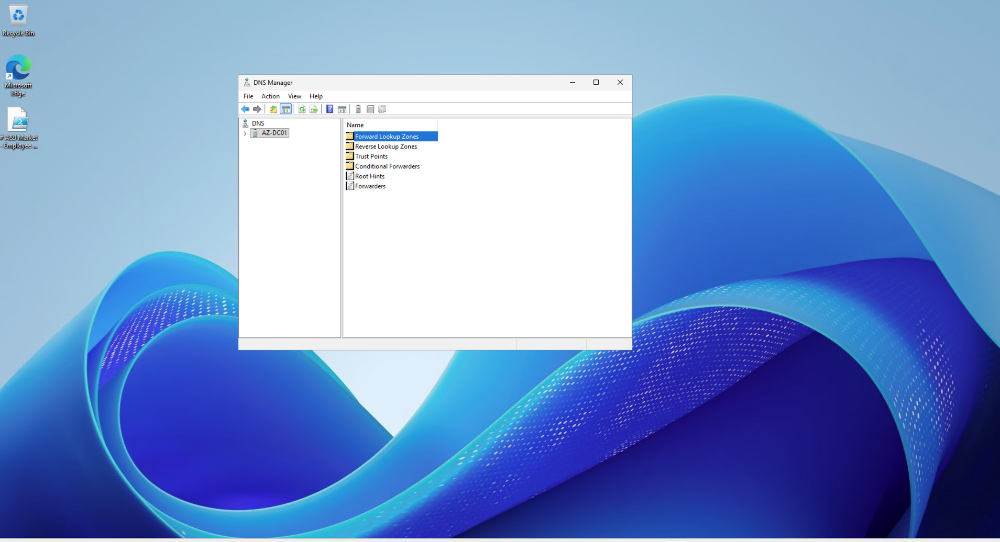
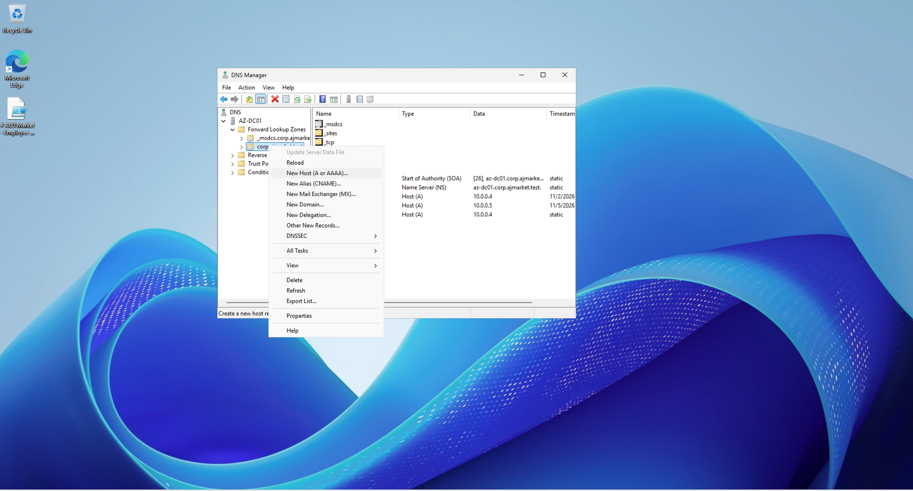
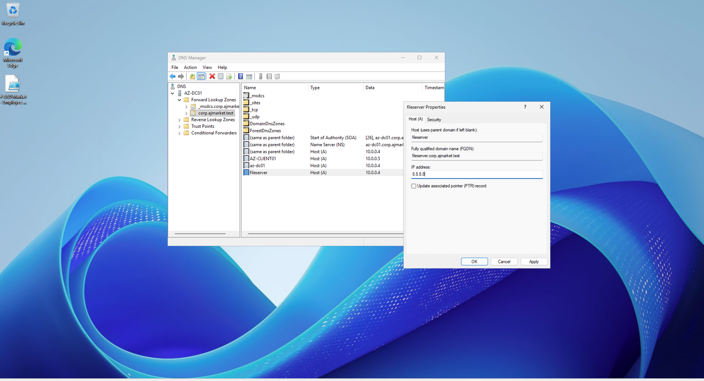
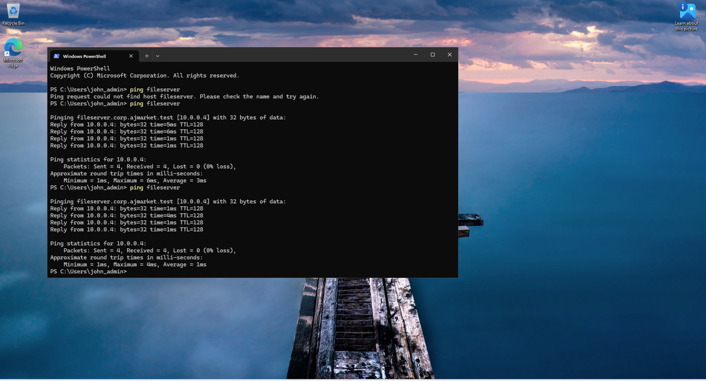
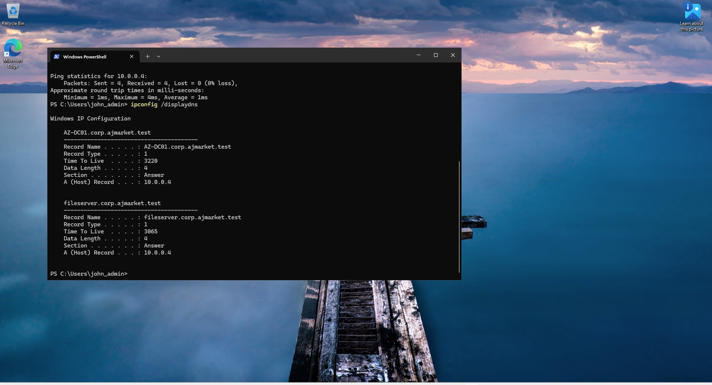
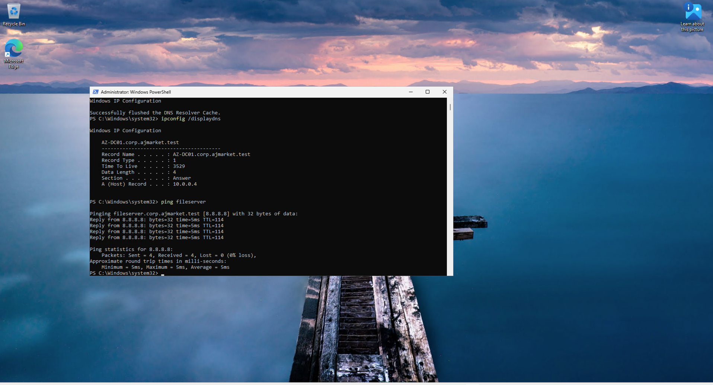
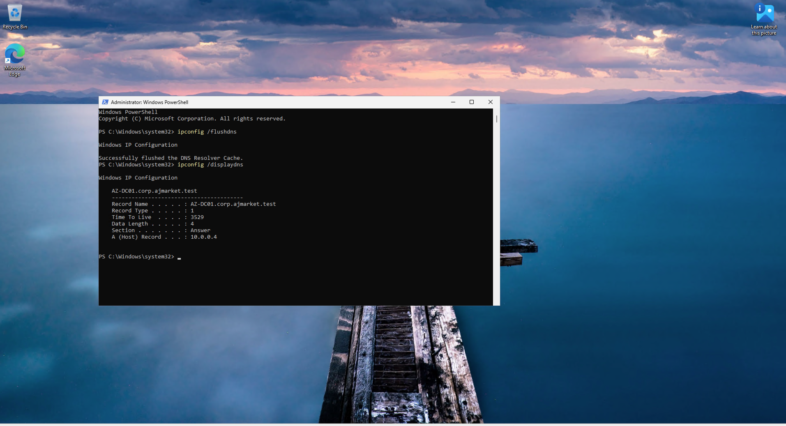
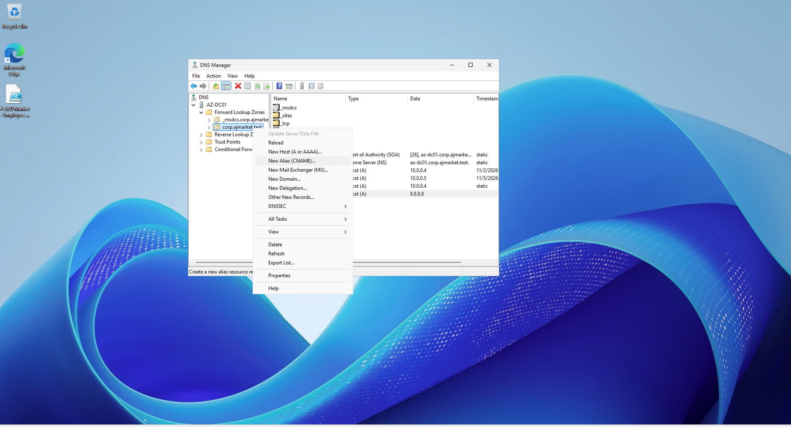
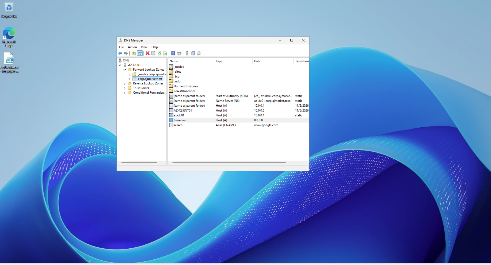
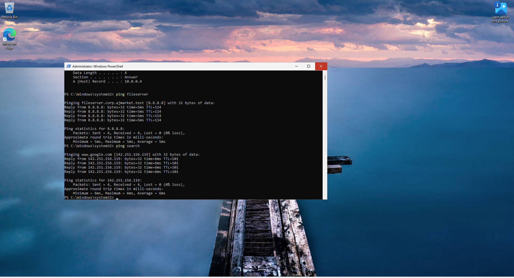

# Stage 4 — DNS Configuration and Troubleshooting

## 1. Project Overview

This stage focuses on configuring and troubleshooting Domain Name System (DNS) services in the A&J Market Active Directory environment.

Using Windows Server 2025 and Windows 11, I created DNS records, tested hostname resolution, examined local DNS caching, and verified DNS changes using networking commands.

The objective was to gain hands-on experience with DNS administration and troubleshooting in a Windows domain environment.

## 2. Environment Configuration

- **Cloud Platform:** Microsoft Azure
- **Domain Controller / DNS Server:** AZ-DC01 (Windows Server 2025)
- **Client Computer:** AZ-CLIENT01 (Windows 11 Pro)
- **Active Directory Domain:** corp.ajmarket.test
- **DNS Server Private IP:** 10.0.0.4
- **Client Private IP:** 10.0.0.5

## 3. Technologies and Tools

- Windows Server DNS Manager
- Active Directory Domain Services
- DNS A Records
- DNS CNAME Records
- Windows DNS Resolver Cache
- Command Prompt
- PowerShell
- `ping`
- `nslookup`
- `ipconfig /displaydns`
- `ipconfig /flushdns`

## 4. Implementation Stages

1. Test hostname resolution before creating a DNS record.
2. Create a DNS A record for `fileserver` pointing to `10.0.0.4`.
3. Verify hostname resolution from the Windows 11 client.
4. Change the A record to `8.8.8.8` and examine the locally cached DNS result.
5. Flush the DNS resolver cache and verify the updated record.
6. Create a DNS CNAME record named `search` pointing to `www.google.com`.
7. Test the CNAME record using `ping` and `nslookup`.
8. Restore the `fileserver` A record to `10.0.0.4` and verify name resolution.

## 5. Project Outcome

Successfully configured and tested DNS records within the A&J Market domain.

Demonstrated how DNS A records map hostnames to IPv4 addresses, how CNAME records provide aliases for existing hostnames, and how locally cached DNS information can affect name resolution after a record changes.

Used `ping`, `nslookup`, and Windows DNS cache commands to investigate and verify DNS behavior.

Restored the original `fileserver` record after completing the troubleshooting exercises.

## Step 1: Testing DNS Resolution Before Creating an A Record

On the Windows 11 client virtual machine (`AZ-CLIENT01`), I opened Windows Terminal and attempted to ping the hostname `fileserver` using the following command:

```powershell
ping fileserver
```

The command failed because the DNS server did not yet have a host record for `fileserver`. This established a baseline for testing DNS name resolution before configuring the DNS record.


## Step 2: Creating a DNS A Record for Fileserver

1. Signed in to the Windows Server 2025 domain controller (`AZ-DC01`).
2. Opened **Server Manager → Tools → DNS** to launch DNS Manager.
3. Expanded the server and navigated to **Forward Lookup Zones → corp.ajmarket.test**.
4. Right-clicked the domain zone and selected **New Host (A or AAAA)**.
5. Entered the following settings:
   - **Name:** `fileserver`
   - **IP address:** `10.0.0.4`
6. Clicked **Add Host** to create the DNS A record.

This record maps the hostname `fileserver.corp.ajmarket.test` to the private IP address of the domain controller.







## Step 3: Verifying DNS Resolution After Creating the A Record

After creating the DNS A record on `AZ-DC01`, I returned to the Windows 11 client (`AZ-CLIENT01`) to test hostname resolution.

1. Opened Windows Terminal on `AZ-CLIENT01`.
2. Entered the following command:

```powershell
ping fileserver
```

3. Confirmed that the hostname `fileserver` resolved to `10.0.0.4` and that the ping received successful replies.

This verified that the client could resolve the hostname using the DNS A record configured on the domain controller.


## Step 4: Modifying the DNS A Record to Test DNS Caching

After confirming that `fileserver` resolved correctly, I modified its DNS A record to observe how the Windows client handles cached DNS information.

1. Returned to the domain controller (`AZ-DC01`).
2. Opened **DNS Manager** and navigated to **Forward Lookup Zones → corp.ajmarket.test**.
3. Located the existing `fileserver` A record.
4. Opened the record's properties and changed its IP address from `10.0.0.4` to `8.8.8.8`.
5. Saved the updated DNS record.
6. Returned to `AZ-CLIENT01` and opened Windows Terminal.
7. Executed the following command:

```powershell
ping fileserver
```

Despite the DNS record being updated, the client continued resolving `fileserver` to the previous IP address, `10.0.0.4`.

This demonstrated that Windows had retained the earlier DNS resolution result in its local DNS cache.






## Step 5: Viewing and Clearing the DNS Client Cache

After changing the `fileserver` A record, I investigated why the Windows 11 client continued resolving the hostname to its previous IP address.

1. Opened Windows Terminal on `AZ-CLIENT01`.
2. Displayed the locally cached DNS records using:

```powershell
ipconfig /displaydns
```

3. Examined the DNS cache and confirmed that the previous IP address, `10.0.0.4`, was still stored locally.
4. Cleared the DNS resolver cache using:

```powershell
ipconfig /flushdns
```

5. Ran the following command again:

```powershell
ping fileserver
```

6. Confirmed that `fileserver` now resolved to the updated IP address, `8.8.8.8`.
7. Reviewed the DNS cache again to observe the updated resolution information.

This troubleshooting exercise demonstrated how locally cached DNS records can temporarily cause a Windows client to use outdated IP addresses, even after the DNS server record has been changed. Clearing the cache forced the client to request updated DNS information.








## Step 6: Creating a DNS CNAME Alias Record

After testing DNS A records and DNS caching, I configured a Canonical Name (CNAME) record to demonstrate how DNS aliases work.

1. Signed in to the domain controller (`AZ-DC01`).
2. Opened **Server Manager → Tools → DNS**.
3. Navigated to **Forward Lookup Zones → corp.ajmarket.test**.
4. Right-clicked the domain zone and selected **New Alias (CNAME)**.
5. Configured the following settings:
   - **Alias name:** `search`
   - **Fully qualified domain name (FQDN) for target host:** `www.google.com`
6. Clicked **OK** to create the CNAME record.
7. Verified that the new `search` alias appeared in DNS Manager.

The resulting alias, `search.corp.ajmarket.test`, points to `www.google.com`. Unlike an A record, which maps a hostname directly to an IPv4 address, a CNAME record maps one DNS name to another DNS name.






## Step 7: Verifying the DNS CNAME Alias

After creating the CNAME record on `AZ-DC01`, I tested DNS resolution from the Windows 11 client (`AZ-CLIENT01`).

1. Opened Windows Terminal on `AZ-CLIENT01`.
2. Tested the alias using the following command:

```powershell
ping search
```

3. Confirmed that the alias resolved successfully through DNS.
4. Ran the following command to examine the DNS lookup:

```powershell
nslookup search
```

5. Verified that the DNS lookup identified the alias associated with `www.google.com` and returned the corresponding DNS resolution information.

These tests demonstrated that the client could resolve the CNAME alias configured on the domain controller. They also showed the difference between using `ping` to test name resolution and connectivity and using `nslookup` to inspect DNS lookup results.




## Step 8: Restoring the Original DNS A Record

After completing the DNS caching and CNAME exercises, I restored the `fileserver` A record to its original IP address.

1. Signed in to the domain controller (`AZ-DC01`).
2. Opened **DNS Manager**.
3. Navigated to **Forward Lookup Zones → corp.ajmarket.test**.
4. Located the `fileserver` A record and opened its properties.
5. Changed the IP address from `8.8.8.8` back to `10.0.0.4`.
6. Saved the updated DNS record.
7. On the Windows 11 client (`AZ-CLIENT01`), verified the restored record using:

```powershell
nslookup fileserver
```

The lookup confirmed that `fileserver` once again resolved to `10.0.0.4`, restoring the original DNS configuration after testing.

### Final Outcome

Successfully configured and tested DNS A and CNAME records in a Windows Server 2025 Active Directory environment. Demonstrated hostname resolution, DNS cache inspection and clearing, DNS record modification, and troubleshooting using `ping`, `nslookup`, and `ipconfig`.
