# Stage 5 — Network File Shares and Permissions

## Project Overview

In this lab, I configured and tested network file shares on a Windows Server 2025 domain controller hosted in Microsoft Azure. I implemented different folder access permissions and used Active Directory security groups to control access to shared resources.

## Lab Environment

- **Cloud Platform:** Microsoft Azure
- **Domain Controller:** AZ-DC01 (Windows Server 2025)
- **Client Computer:** AZ-CLIENT01 (Windows 11 Pro)
- **Active Directory Domain:** corp.ajmarket.test
- **Shared Folders:** read-access, write-access, no-access, accounting
- **Security Group:** ACCOUNTANTS

## Technologies and Tools

- Windows Server 2025
- Active Directory Domain Services (AD DS)
- Active Directory Users and Computers (ADUC)
- Windows File Explorer
- SMB Network File Sharing
- Windows Share Permissions
- Active Directory Security Groups

## Lab Objectives

1. Create folders for network file sharing.
2. Configure different levels of shared-folder permissions.
3. Access shared folders from a domain-joined Windows 11 client.
4. Verify read-only, write, and restricted access.
5. Create an Active Directory security group for accounting users.
6. Assign permissions using security group membership.
7. Verify that group membership grants access to the accounting folder.

## Implementation and Testing

### Step 1: Creating Folders for Network File Sharing

I began by creating four folders on the Windows Server 2025 domain controller (`AZ-DC01`) to demonstrate different levels of network file access.

1. Signed in to `AZ-DC01`.
2. Opened **File Explorer**.
3. Navigated to the **C:\** drive.
4. Right-clicked an empty area and selected **New → Folder**.
5. Created the following four folders:
   - `read-access`
   - `write-access`
   - `no-access`
   - `accounting`
6. Verified that all four folders appeared in the root of the C: drive.

These folders were used to configure and test read-only access, write access, restricted access, and Active Directory security group-based access.

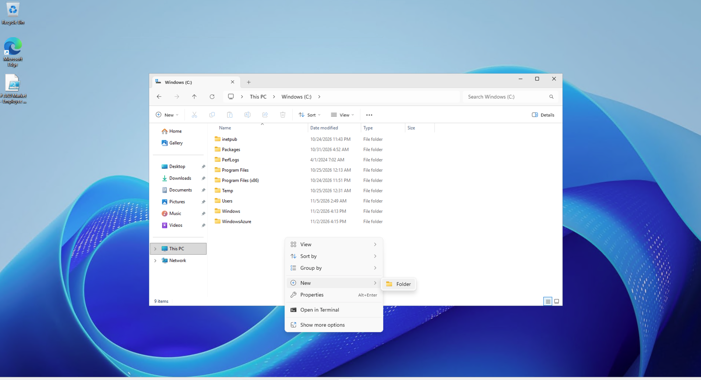

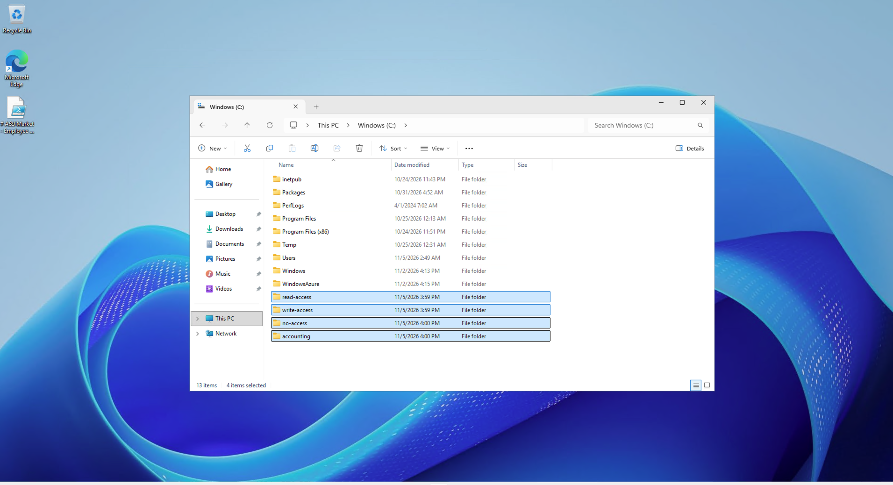

### Step 2: Configuring Read-Only Network Share Permissions

After creating the folders, I configured the `read-access` folder to allow domain users to view files without modifying them.

1. On `AZ-DC01`, opened **File Explorer** and navigated to `C:\read-access`.
2. Right-clicked the folder and selected **Properties**.
3. Opened the **Sharing** tab and clicked **Advanced Sharing**.
4. Enabled **Share this folder** and opened **Permissions**.
5. Configured the `Domain Users` group with the following share permissions:
   - **Read:** Allow
   - **Change:** Not allowed
   - **Full Control:** Not allowed
6. Applied the settings and saved the sharing configuration.

These share permissions restricted members of the `Domain Users` group to read-only access through the network share. Effective access also depends on the folder's NTFS permissions.

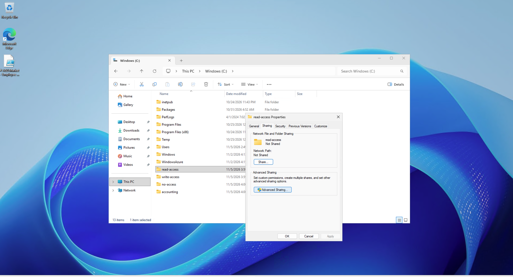

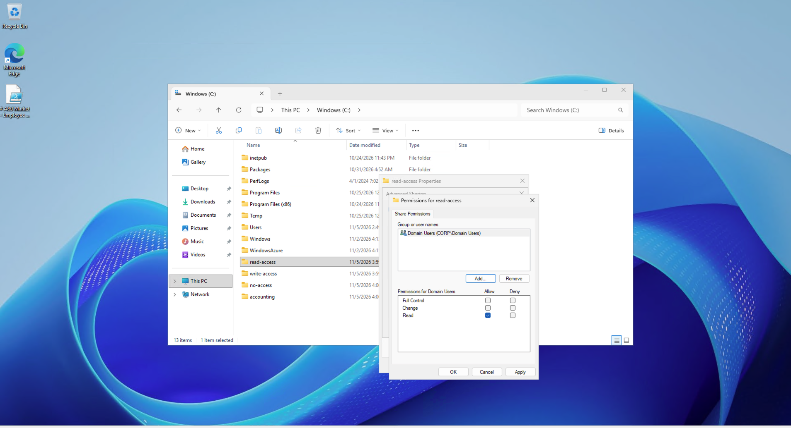

### Step 3: Configuring Write-Access Network Share Permissions

After configuring the read-only folder, I configured the `write-access` folder to allow domain users to create and modify files through the network share.

1. On `AZ-DC01`, opened **File Explorer** and located `C:\write-access`.
2. Right-clicked the folder and selected **Properties**.
3. Opened the **Sharing** tab and selected **Advanced Sharing**.
4. Enabled **Share this folder** and clicked **Permissions**.
5. Configured the `Domain Users` group to allow **Change** and **Read** permissions.
6. Applied the changes and saved the sharing configuration.

The **Change** share permission allows users to create, modify, and delete files through the network share, provided the folder's NTFS permissions also allow those operations.


### Step 4: Accessing Network Shares from the Windows 11 Client

After configuring the network shares on `AZ-DC01`, I connected to them from the domain-joined Windows 11 client (`AZ-CLIENT01`) to verify that the folders were accessible over the network.

1. Signed in to `AZ-CLIENT01` using a domain user account.
2. Pressed **Windows + R** to open the Run dialog.
3. Entered the following UNC path:

```text
\\AZ-DC01
```

4. Pressed **Enter** to open the server's available network shares in File Explorer.
5. Confirmed that the shared folders were displayed, including `read-access`, `write-access`, `no-access`, and `accounting`.

This demonstrated that the Windows 11 client could locate the domain controller and browse its published SMB network shares. Access to the contents of each folder was tested separately.


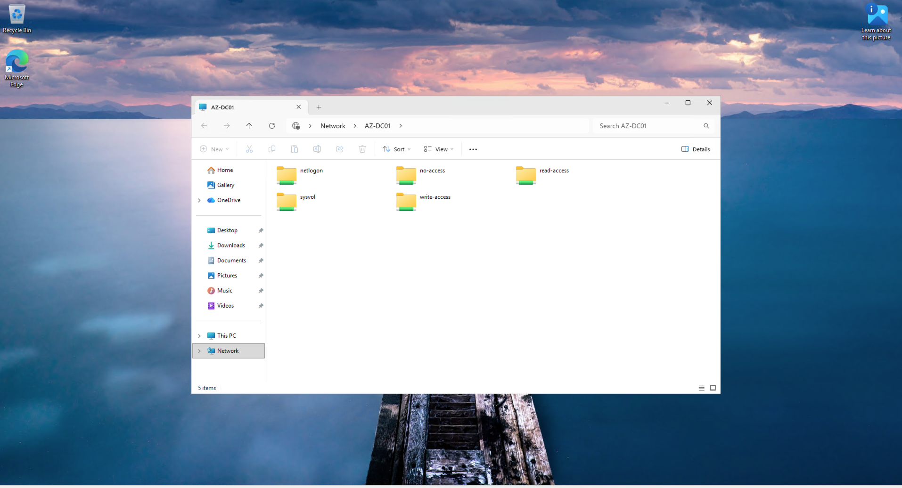

### Step 5: Testing Network Share Permissions

After connecting to the shared folders from `AZ-CLIENT01`, I tested the different permission levels to verify that access restrictions worked as intended.

**Test 1: Read-Only Access**

1. Opened the `read-access` network share.
2. Attempted to create a new text document inside the folder.
3. Confirmed that the operation was restricted because the user did not have write permission.

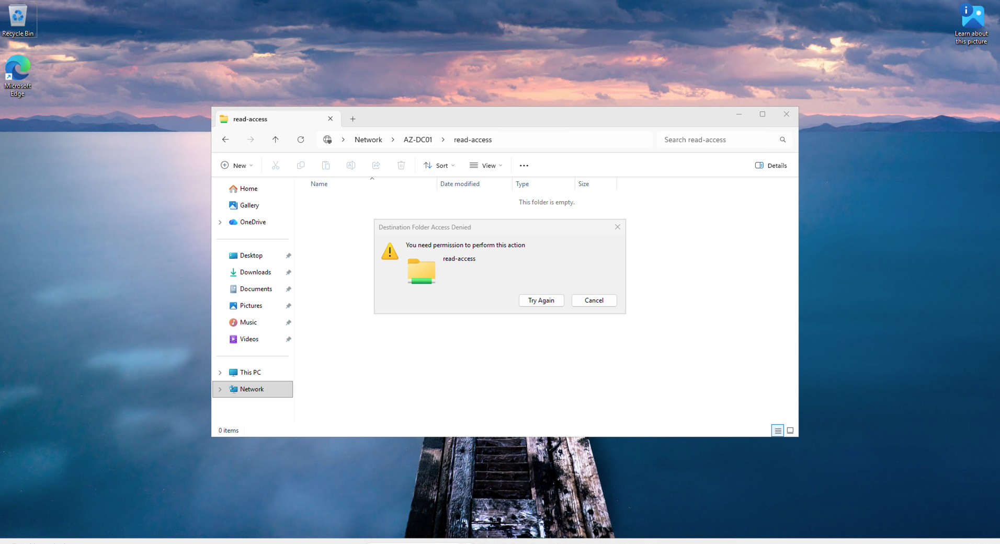

**Test 2: Write Access**

1. Opened the `write-access` network share.
2. Attempted to create a new file inside the folder.
3. Successfully created the file, confirming that write access was permitted.


**Test 3: Restricted Access**

1. Attempted to open the `no-access` network share.
2. Received an access-denied message.
3. Confirmed that the account did not have permission to access the folder.

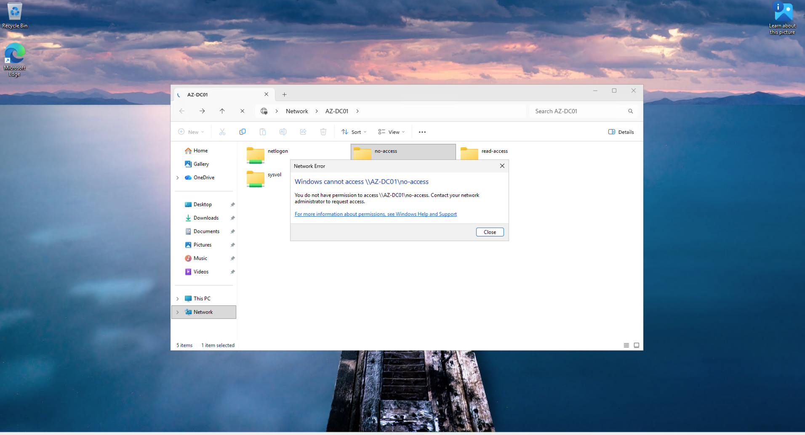

**Result:** The tests demonstrated that the configured network share permissions produced different access levels for the domain user. Read-only access prevented file creation, write access allowed file creation, and restricted access blocked entry to the folder.

The effective permissions for network files depend on both SMB share permissions and NTFS permissions.

### Step 6: Configuring Permissions for the Restricted Folder

I configured the `no-access` folder to demonstrate how network share permissions can restrict access to sensitive resources.

1. On `AZ-DC01`, opened **File Explorer**.
2. Located the `C:\no-access` folder.
3. Right-clicked the folder and selected **Properties**.
4. Opened **Sharing → Advanced Sharing → Permissions**.
5. Reviewed the permissions assigned to the administrative group for the restricted share.
6. Saved the configuration and tested access from `AZ-CLIENT01` using a domain user account.

The domain user received an access-denied message when attempting to open the `no-access` folder, demonstrating that the account did not have the required effective permissions.

This exercise highlighted the importance of restricting access to shared resources based on user roles and administrative requirements.

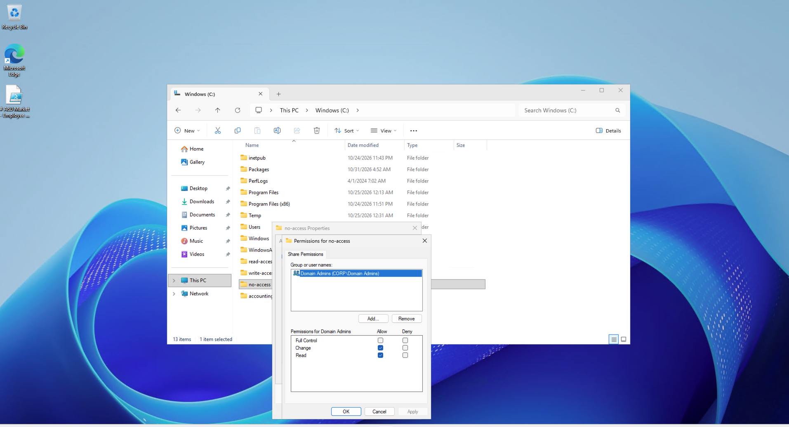

### Step 7: Creating an Active Directory Security Group

To manage access to the accounting shared folder, I created an Active Directory security group named `ACCOUNTANTS`.

1. Signed in to the domain controller (`AZ-DC01`).
2. Opened **Server Manager → Tools → Active Directory Users and Computers**.
3. Expanded the `corp.ajmarket.test` domain.
4. Navigated to the `_ADMINS` organizational unit.
5. Right-clicked the organizational unit and selected **New → Group**.
6. Entered `ACCOUNTANTS` as the group name.
7. Selected **Global** as the group scope and **Security** as the group type.
8. Clicked **OK** to create the group.
9. Verified that the new `ACCOUNTANTS` group appeared in Active Directory Users and Computers.

Creating a security group allows administrators to assign folder permissions to a group rather than managing permissions individually for each user. This simplifies access management as employees join or leave a department.

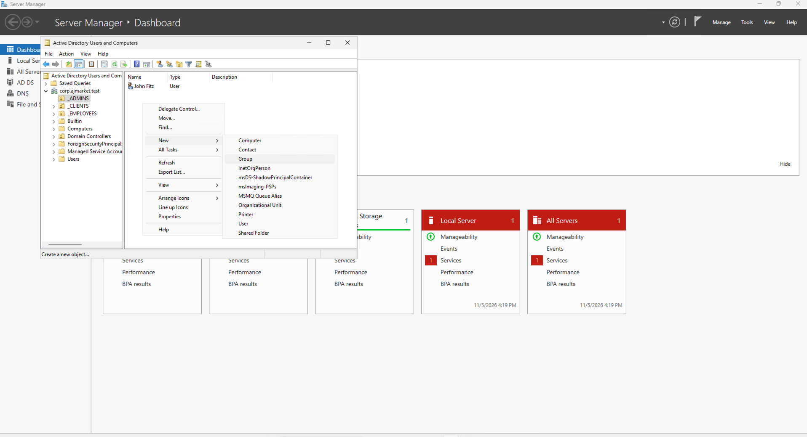

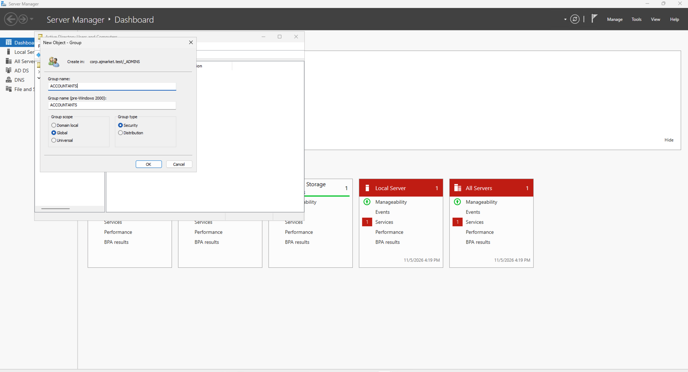

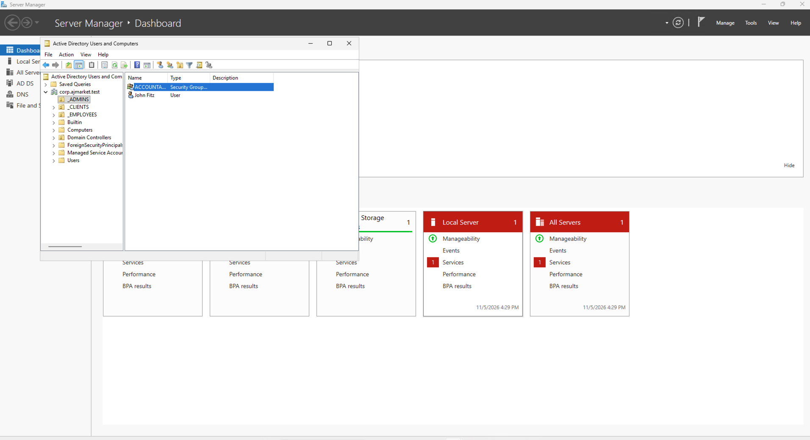

### Step 8: Configuring Group-Based Access to the Accounting Folder

After creating the `ACCOUNTANTS` security group, I configured the accounting shared folder to control access through Active Directory group membership.

1. On `AZ-DC01`, opened **File Explorer**.
2. Located the `C:\accounting` folder.
3. Right-clicked the folder and selected **Properties**.
4. Opened **Sharing → Advanced Sharing → Permissions**.
5. Added the `ACCOUNTANTS` security group to the share permissions.
6. Selected the group and configured its permitted access.
7. Applied the settings and saved the configuration.

This configuration allowed access to the accounting share to be managed through security group membership rather than individual user permissions. Effective network access also depends on the folder's NTFS permissions and any other applicable group permissions.

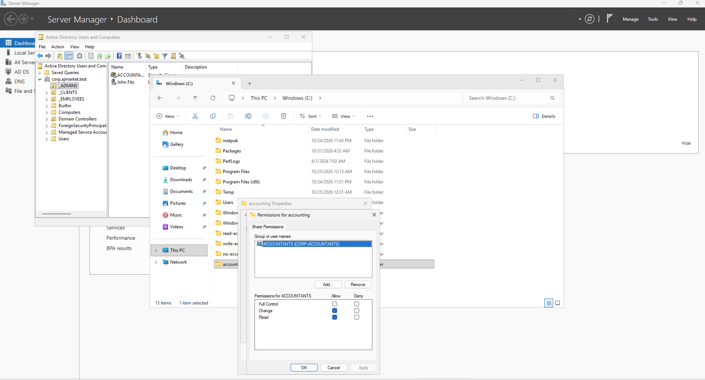

### Step 9: Testing Accounting Folder Access Before Group Membership

After configuring permissions for the `accounting` shared folder, I tested whether a user who was not a member of the `ACCOUNTANTS` security group could access it.

1. Signed in to `AZ-CLIENT01` using the domain user account `Quip`.
2. Opened File Explorer and attempted to access the `accounting` network share hosted on `AZ-DC01`.
3. Received an access-denied message when attempting to open the folder.
4. Confirmed that the user did not have the required permissions to access the accounting share.

This test established a baseline before modifying the user's Active Directory group membership. It demonstrated that access to the accounting folder was restricted for this account.

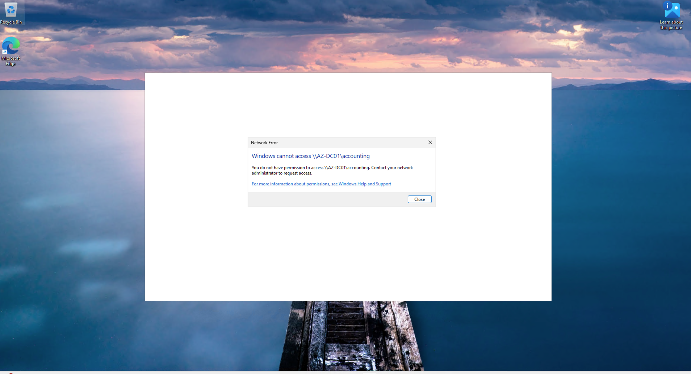

### Step 10: Adding a User to the ACCOUNTANTS Security Group

After confirming that Quip could not access the accounting shared folder, I added the user to the `ACCOUNTANTS` security group in Active Directory.

1. Signed in to the domain controller (`AZ-DC01`).
2. Opened **Server Manager → Tools → Active Directory Users and Computers**.
3. Navigated to the `ACCOUNTANTS` security group within the `_ADMINS` organizational unit.
4. Right-clicked the group and selected **Properties**.
5. Opened the **Members** tab and clicked **Add**.
6. Entered the Quip user account, selected **Check Names**, and clicked **OK**.
7. Applied the changes and verified that Quip appeared in the group's membership list.

This demonstrated how Active Directory security groups can be used to grant access to shared resources without assigning permissions directly to individual user accounts.

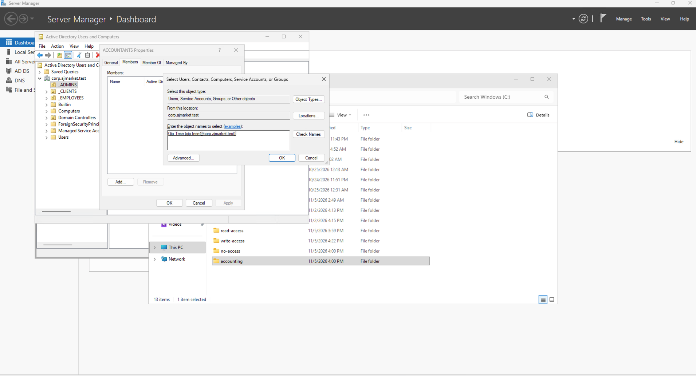

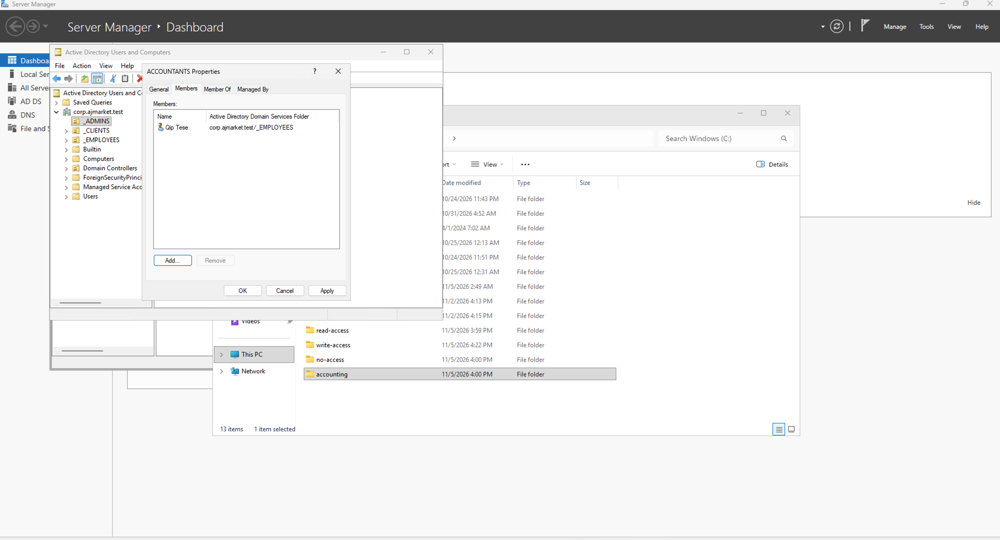

### Step 11: Verifying Accounting Folder Access After Group Membership

After adding Quip to the `ACCOUNTANTS` security group, I tested access to the accounting shared folder again.

1. Returned to the Windows 11 client (`AZ-CLIENT01`).
2. Used the Quip domain user account to access the network shares hosted on `AZ-DC01`.
3. Opened the `accounting` shared folder.
4. Confirmed that Quip could now access the folder successfully.

This demonstrated that Active Directory security group membership could be used to control access to a shared network resource. Previously, Quip was denied access; after joining the `ACCOUNTANTS` group and using updated account credentials, the user could access the folder.

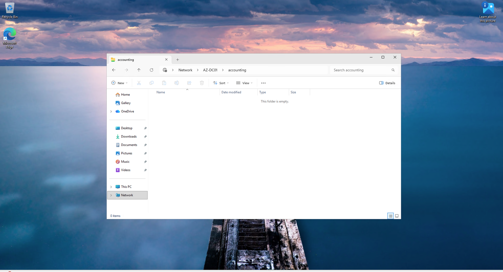

## Final Project Outcome

Successfully configured and tested SMB network file shares in a Windows Server 2025 Active Directory environment hosted in Microsoft Azure.

The lab demonstrated:

- Creating and sharing folders on a Windows Server domain controller.
- Configuring read-only, write, and restricted network access.
- Testing permissions from a domain-joined Windows 11 client.
- Creating and managing Active Directory security groups.
- Granting access to shared resources through group membership.
- Applying role-based access principles to network file sharing.

This project strengthened my practical understanding of Windows Server administration, SMB file sharing, Active Directory security groups, and network access control.
